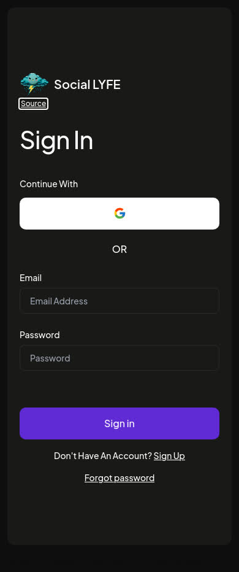
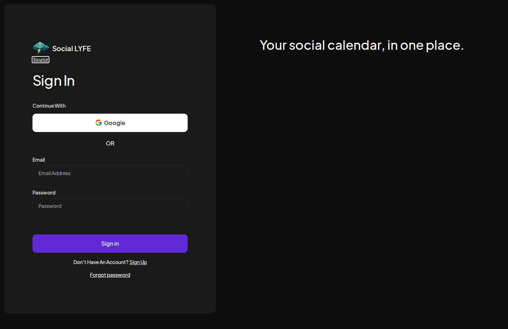

# Social LYFE calendar branding

Rexx requested **Social LYFE**, using the existing **LYFEY** artwork. This replaces the older Social BizBox branding proposal in the same PR.

The sidebar mark, sign-in wordmark, page titles, logout label, favicon and Apple touch icon use the new name and existing LYFEY cloud. The upstream sign-in customer-count/testimonial panel is replaced with neutral calendar copy. Postiz attribution and AGPL licence are preserved, with a visible source link beside both logo variants and the existing root footer.

## Validation

- Full pinned v2.25.0 candidate frontend production build, including TypeScript: exit 0.
- Actual built sign-in page: Chromium/WebKit at 390px and 1440px; four layouts passed. Logo loaded, Social LYFE title correct, source link visible, no horizontal overflow or page errors.
- Actual compact/full logo components: four isolated browser layouts passed, including the 64px sidebar rail.
- Independent scoped source review: two source-link accessibility findings fixed and re-reviewed clear. Actual light/dark theme and keyboard-focus checks pass in both browsers; contrast 17.54:1 dark / 19.30:1 light, source link fits the 64px rail and 92px billing-header fixture. Built login keyboard-focus check also passed.
- No provider, credential, database, scheduled-post or publishing logic changed.

Browser QA intercepted external calls. It did not submit sign-in, create accounts, authorize providers, exercise authenticated calendar screens, or publish content.

## Release status

Source and Production build/preview only. Live service still uses the existing upstream image until the required coordinator/release gates clear. This PR builds on the existing lane-D candidate branch; those pre-existing calendar/media fixes have their own earlier review record. No live database migration is authorized by this branding patch.

Asset provenance and structured browser receipts are alongside this file. Existing docs/social-bizbox receipts describe the historical candidate, not the current live branding.
